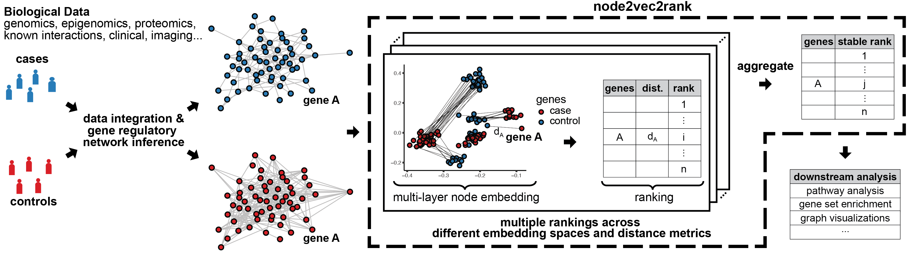

<!-- PROJECT SHIELDS -->
[![Contributors][contributors-shield]][contributors-url]
[![Forks][forks-shield]][forks-url]
[![Stargazers][stars-shield]][stars-url]
[![Issues][issues-shield]][issues-url]
[![Tests][tests-shield]][tests-url]
[![GPL-3.0 License][license-shield]][license-url]

<!-- PROJECT LOGO -->
<br />
<p align="center">
 <!--  -->
  <h3 align="center"> node2vec2rank: Large Scale and Stable Graph Differential Analysis via Node Embeddings and Ranking</h3>

  <p align="center">
    <br />
    <br />
    <a href="https://github.com/pmandros/node2vec2rank/issues">Report Bug</a>
    ·
    <a href="https://github.com/pmandros/node2vec2rank/pulls">Add Feature</a>
  </p>
</p>


<!-- TABLE OF CONTENTS -->
<details open="open">
  <summary><h2 style="display: inline-block">Table of Contents</h2></summary>
  <ol>
    <li>
      <a href="#about-the-project">About The Project</a>
    </li>
    <li>
      <a href="#getting-started">Getting Started</a>
      <ul>
        <li><a href="#installation">Installation</a></li>
      </ul>
    </li>
    <li><a href="#usage">Usage</a></li>
    <li><a href="#citation">Citation</a></li>
      <li><a href="#practicalities">Practicalities</a></li>
    <li><a href="#contributing">Contributing</a></li>
   <li><a href="#license">License</a></li>
    <li><a href="#contact">Contact</a></li>
  </ol>
</details>


<!-- ABOUT THE PROJECT -->
## About The Project
This is the code repository for https://www.biorxiv.org/content/10.1101/2024.06.16.599201v1. <br>

Computational methods in biology can infer large molecular interaction networks from multiple data modalities and resolutions, creating unprecedented opportunities to better understand complex biological phenomena. Such graphs can be built from different conditions and get contrasted to uncover graph-level differences, e.g., a case-control study utilizing gene regulatory networks. <br> 
Towards this end, we introduce **node2vec2rank**, a method for graph differential analysis that ranks nodes  according to the disparities of their representations in joint latent embedding spaces. Unlike previous bag-of-features approaches, we leverage recent advances in machine learning and statistics to compare graphs in higher-order structures and in a data-driven manner. Node2vec2rank is computationally efficient and can provably identify the correct ranking of differences. Furthermore, we incorporate stability into n2v2r for an overall procedure that adheres to veridical data science principles by running it multiple times and aggregating the results. See figure below for a demonstration simulating a case-control study. <br>

The method is not limited to comparing only two graphs. Given multiple graphs, there exist strategies such as one-versus-rest that compute pairwise comparisons based on vector arithmetic on the multi-layer node embeddings (see <a href="#practicalities">practicalities</a>).

Note, that in our case, node2vec in the title does not correspond to the algorithm by Grover and Leskovec, but rather to any algorithm that can produce (multi-layer) node embeddings. An earlier version of node2vec2rank was using node2vec with transfer learning, but it was unstable and with many paramaters. UASE is based on SVD and is more stable, more efficient, has practically no parameters, and we were able to provide theoretical guarantees about the correct ranking.  <br>

While the method is motivated and validated with biological applications, it can be used in any other domain with similar objectives. <br>

This repository provides the method, source code, and example notebooks. In particular, we provide the notebooks corresponding to the biological applications used in the paper, as well as a demo notebook for the general usage. 




<!-- GETTING STARTED -->
## Getting Started

To get a local copy up and running follow steps below.

### Installation

node2vec2rank needs Python 3.9 or newer. Install it with pip, ideally in a fresh virtual or conda environment:
   ```sh
   pip install git+https://github.com/pmandros/node2vec2rank
   ```
The core method only depends on numpy, pandas, scipy and networkx. To also run the enrichment analyses and plots in `post_utils` (as in the paper notebooks), install the `enrichment` extra:
   ```sh
   pip install "node2vec2rank[enrichment] @ git+https://github.com/pmandros/node2vec2rank"
   ```

To work from a local copy, e.g., to run the notebooks, clone the repository and install it in editable mode:
   ```sh
   git clone https://github.com/pmandros/node2vec2rank
   cd node2vec2rank
   pip install -e ".[enrichment,test]"
   pytest
   ```
The pinned conda environment used for the paper is still available with `conda env create --file environment.yaml`, followed by `conda activate n2v2r` and `pip install .`.

<!-- USAGE EXAMPLES -->
## Usage

### Running node2vec2rank in command line
To run the node2vec2rank algorithm in command line, run the following command with a configuration file as input
   ```sh
   n2v2r --config configs/config_demo_adj_CLI.json
   ```
`python -m node2vec2rank --config ...` works too. `--save_dir` and `--seed` override the config file, `--signed` also writes the rankings signed by the degree difference, `--significance` writes per-node p- and q-values, `--align both|robust|none` overrides `align` (`none` is the method of the paper, see [below](#what-the-default-measures-total-move-and-own-move)), `--wald` writes the chi-square test per node, and `--modules` writes which modules changed and how (see [below](#which-module-changed)). Any parameter left out of the config file takes its default value.
The configuration file template is as follows
   ```json
{
    "data_io": {
        "save_dir": "<path_to_output>",
        "data_dir": "<path_to_data>",
        "graph_filenames": ["network_control.tsv","network_case.tsv"],
        "separator": "\t",
        "is_edge_list": false,
        "transpose": false
    },
    "data_preprocessing": {
        "project_unipartite_on": null,
        "threshold": null,
        "top_percent_keep": 100,
        "binarize": false,
        "absolute": false
    },
    "fitting_ranking": {
        "embed_dimensions": [4,6,8,10,12,14,16,18,20,22,24],
        "distance_metrics": ["euclidean","cosine"],
        "align": "both",
        "comp_strategy": "sequential",
        "seed": null,
        "verbose": 1
    }
}
   ```
The configuration parameters have the following functionality
```sh
data_io:
  --save_dir SAVE_DIR   Save directory
  --graph_filenames [GRAPH_FILENAMES ...]
                        Graph filenames
  --data_dir DATA_DIR   Data Directory
  --separator SEPARATOR
                        Separator used in the graph files
  --is_edge_list        Whether the input is an edge list or tabular
  --transpose           Whether to transpose the graph adjacency matrices or not if bipartite

data_preprocessing:
  --project_unipartite_on PROJECT_UNIPARTITE_ON
                        If the graph adjacency matrices are non-square (i.e., bipartite), it will make them square by projecting into column or row space
  --threshold THRESHOLD
                        Everything below this value will be 0
  --top_percent_keep TOP_PERCENT_KEEP
                        Keeps the top percentage of edges, turning the rest to 0
  --binarize            Whether to binarize the graphs, turning everything above 0 to 1
  --absolute            Absolute the graphs, i.e., turn negative values into positive

fitting_ranking:
  --embed_dimensions [EMBED_DIMENSIONS ...]
                        A list of all the embedding dimensions to use in n2v2r 
  --distance_metrics [DISTANCE_METRICS ...]
                        A list of all the distance metrics to use in n2v2r ("euclidean", "cosine", "radial" and/or "correlation"; radial is the change of a node's norm, i.e. of its hub status; correlation depends on the arbitrary signs of the singular vectors and is not recommended)
  --align ALIGN         "both" (default): rank and test every node on its total move between the embeddings and on its own move, after the move shared by the majority of the nodes is removed with a robust linear fit; null: the total move only (the method of the paper); "robust": the own move only (see "What the default measures" below)
  --comp_strategy COMP_STRATEGY
                        How to compare more than two graphs: "sequential" (default), "one_vs_before" or "one_vs_rest"
  --embedding_method EMBEDDING_METHOD
                        "uase" (default) or "ulse" (regularised unfolded Laplacian embedding)
  --seed SEED           Random seed
  --verbose VERBOSE     Verbose level
```
### Using node2vec2rank from Python
Graphs can be passed directly as a list of square adjacency matrices (numpy arrays, scipy sparse matrices or pandas DataFrames) over the same nodes. Parameters are keyword arguments and default to the values above.
```python
from node2vec2rank import N2V2R

model = N2V2R([graph_control, graph_case], nodes=gene_names, seed=42)
rankings = model.fit_transform_rank()          # one DataFrame per comparison, one column per dimension/metric
borda = model.aggregate_transform()            # aggregated Borda ranking per comparison (borda_ranks, borda_total, borda_own)
degree_difference = model.degree_difference_ranking()
signed = model.signed_ranks_transform()        # rankings signed by the degree difference
significance = model.significance()            # per-node z, p- and q-values, and the share of the move that is the node's own
wald = model.wald_test()                       # chi-square test per node, for networks with independent edges
modules = model.module_changes()               # which modules changed and how; model.pairwise_modules has the module of every node

paper = N2V2R([graph_control, graph_case], nodes=gene_names, seed=42, align=None)  # the method exactly as in the paper
```
To load graphs from files with the same options as the command line, use `DataLoader`:
```python
from node2vec2rank import DataLoader, N2V2R

loader = DataLoader("configs/config_demo_adj_CLI.json")
model = N2V2R(loader.get_graphs(), loader.get_nodes(), config=loader.config)
```

### What the default measures: total move and own move
A node can move between the two embeddings for two reasons, and by default (`align="both"`) node2vec2rank ranks and tests every node on both.

- **Total move** (the method of the paper, `align=null`): the distance between the node's two positions. It answers "did the connections of this node change?". That includes a change the node shares with its whole community (a module becomes stronger or weaker, two communities merge). It also includes the smaller change of a node whose partners changed: in a joint embedding a node's position is its latent position times a matrix that depends on the whole graph, so when many nodes change, every node moves (spill-over).
- **Own move** (`align="robust"`): the distance after the first embedding is mapped onto the second with a linear map fitted on the half of the nodes that moved least (robust alignment, `node2vec2rank/alignment.py`). The move that the majority shares is removed, and what is left answers "did this node change its position relative to the others?". If fewer than half of the nodes changed, the own move of an unchanged node is exactly zero without noise.

Neither replaces the other. When a whole community changes how it connects and its nodes keep their place in it, the embedding of *all* nodes changes by one linear map, which is exactly what alignment removes (in the benchmarks a weakening module and a merge of two communities are lost); the total move keeps it. When many single nodes rewire, the total move of every node is large and the changed ones no longer stand out; the own move finds them. So the default uses both:

- `aggregate_transform()` returns `borda_total` (the ranking of the paper), `borda_own`, and `borda_ranks`, the larger of the two.
- `significance()` tests every node on both moves and reports twice the smaller p-value (valid whatever the dependence between the two tests), the larger z-score, the two z-scores (`z_total`, `z_own`) and `own_share`, the share of the node's squared move that is its own. For a node with a large z, a share near 0 says it moved with its module and a share near 1 that it rewired on its own (about one half is what noise alone gives).
- `fast_gene_set_test` tests every gene set on both z-scores in the same way.

Simulations with 10 replicates (`benchmarks/alignment_wald.py`) and the HeLa cell-cycle data (`benchmarks/alignment_hela.py`); the full tables are in [the benchmarks](benchmarks/README.md#total-and-own-move-the-radial-metric-and-the-chi-square-test):

| | total move only (the paper) | own move only | default |
|---|---|---|---|
| Binary block models, 30% of nodes switch community: AUROC of the Borda ranking | 0.83 | 1.00 | 0.97–0.98 |
| same: changed nodes called by `significance()` (of 300) | 0 | 260–297 | 84–232, 0.1 false calls |
| Co-expression, 10% of genes switch module: AUROC | 0.89–0.96 | 0.99 | 0.97–0.98 |
| same: changed genes called (of 100) | 14–74 | 72–73 | 53–73 |
| Co-expression, 30% switch: AUROC | 0.78–0.80 | 0.84–0.93 | 0.84–0.86 |
| Two communities merge: AUROC | 0.92–0.94 | 0.64–0.77 | 0.89–0.90 |
| One co-expression module weakens (signed network): AUROC | 0.89 | 0.34 | 0.84 |
| Nothing changes: nodes with p < 0.05 | 1.4–2.4% | 1.7–3.8% | 0.8–2.5% |
| HeLa cell cycle, Reactome pathways called (G1→S, S→G2, G2→M) | 131, 44, 31 | 0, 0, 0 | 123, 29, 18 |
| HeLa, three random splits of the G1 cells: pathways called | 0, 0, 0 | 0, 0, 0 | 0, 0, 0 |

Over the 21 simulated settings with a change, the default Borda ranking has a higher AUROC than the ranking of the paper in 15 (by up to 0.16) and a lower one in 5 (by at most 0.05). It is never more than 0.07 below the better of the two single rankings, and up to 0.50 above the worse one.

What it costs to ask two questions at once: the p-value doubles, and the larger of two Borda scores lets the top nodes of a ranking without signal in. When only one kind of change is present, the single ranking for it is sharper than the default: among the top k nodes (k being the number of changed ones) its share of changed nodes is up to 0.16 lower than that of the better single ranking, and with 30% of the nodes changed the test of the own move alone calls more of them (260 against 84 of 300 with heavy-tailed degrees). If you know which question you are asking, read `borda_total` or `borda_own` (`z_total` or `z_own`), or set `align`. `align=null` gives the method exactly as in the paper; the configs of the paper's notebooks set it. Both moves assume that most nodes did not change. A node that only becomes more or less of a hub is found by neither (see the next section). The permutation tests (`permutation_test`, `gene_set_test`) test "the groups do not differ at all" and keep using the total move.

### Significance and diagnostics
`model.significance()` tests every node for a larger shift between the graphs than nodes of similar degree. Each distance is compared against a robust trend with degree (a degree-adjusted empirical null), and the results are combined into one z-score per node, a one-sided p-value and a Benjamini-Hochberg q-value. Like other empirical-null methods, it assumes that most nodes do not change. By default it does this for the total and for the own move of every node and combines the two (see above); the numbers in this section are for the test of the total move alone. The p-values are conservative (typically 0.5–3.5% of unchanged nodes have p < 0.05), so its calls can be trusted but it can miss real changes.

Which combination of dimensions to use (numbers from `benchmarks/README.md`, 10% of nodes changed, power at q < 0.1):

| | `significance()` (default, `combine="cauchy"`) | `significance(combine="mean")` |
|---|---|---|
| How it combines | averages neighbouring pairs of dimensions, then a Cauchy combination test over the pairs | averages all dimensions |
| Use it for | binary or sparse networks, single-cell networks, and anything else where the change may sit in a few leading dimensions | co-expression networks built from bulk samples (WGCNA-style `\|cor\|^6`), where a rewired gene shifts a little in many dimensions |
| Binary SBMs | 0.45–0.87 | 0.00–0.02 |
| Simulated co-expression | 0.12–0.18 | 0.24–0.26 |
| Real locCSN spike-ins | 0.09–0.10 | 0.05 |

Both are calibrated. Neither made a false call in the network simulations, and the Cauchy combination's occasional calls in the hardest co-expression null (one or two genes in 4 of 30 replicates) stay within what the FDR level allows. Their z-scores rank the nodes equally well (AUROC within 0.01), so the choice changes how many nodes pass the cutoff, not their order. If unsure, use the default.

The z-score is also a ranking free of degree bias. Because it adjusts for degree, a node that only becomes more or less of a hub (its connections grow or shrink within its community) is rarely called; look at the degree difference (`degree_difference_ranking`) for those. By default the test combines the same dimensions and metrics as the ranking; `significance(dimensions="elbow")` uses only the dimension at the elbow of the singular values, which is much more powerful when that elbow captures the change and fails when it does not. `n2v2r --significance` writes the results as `<comparison>_significance.tsv`.

`node2vec2rank.diagnostics` measures how much the rankings agree across dimensions and metrics (`ranking_agreement`), how strongly they follow node degree (`degree_bias`), and how often each node is in the top (`top_k_stability`). `node2vec2rank.plotting` draws these, together with the scree plot of the joint embedding (`plot_scree(model.singular_values, model.selected_dimension)`), after `pip install "node2vec2rank[plot]"`.

If you have the samples behind the networks (e.g., expression profiles for co-expression networks), `node2vec2rank.permutation.permutation_test(expression_a, expression_b)` gives a test that does not assume that most nodes are unchanged: it shuffles the samples between the two groups, rebuilds both networks (by default WGCNA-style `|cor|^6`, or any `build_network` function you pass) and compares every node with its own permutation distribution. Its null hypothesis is that the two groups do not differ at all, so its p-values are exact when nothing changes, but it is not a per-node test once something does. Rewiring some genes moves every gene a little in the joint embedding, so genes whose own connections did not change are called too: their partners' module membership changed, or the embedding shifted around them (in `benchmarks/expression.py`, a quarter of the unchanged module partners of the rewired genes). Read its calls as evidence that the networks differ, with the smallest p-values pointing at where, not as a list of changed genes with a controlled FDR. The empirical null in `significance()` instead picks out nodes that changed more than others of similar degree.

`node2vec2rank.permutation.gene_set_test(expression_a, expression_b, gene_sets)` uses the same sample shuffles to test gene sets (a dict or a `.gmt` file, e.g. Reactome): is a set more differential than the rest of the genes? Because whole samples are shuffled, the correlation between the genes of a set stays in the null. GSEA prerank and over-representation tests on a ranking shuffle genes instead, which treats them as independent; in network rankings the genes of a co-expression module move together, so those tests call co-expressed pathways even when nothing differs between the groups (see [the benchmarks](benchmarks/README.md)). Both tests take `strata` (e.g. batch labels, shuffled only within a batch), `n_jobs` for parallel permutations, and `ranking="degree_difference"` to run the degree difference through the same test as a baseline. Every set is compared with its own permutations, so for a large library use 1,000 or more permutations. `node2vec2rank.fast_gene_sets.fast_gene_set_test` gives a quicker, approximate version that needs only about 10 permutations: it models the correlation between genes instead of permuting hundreds of times. It is good for exploring; the benchmarks show it is somewhat less powerful.

For single-cell data, `node2vec2rank.singlecell` keeps the counts sparse (`normalize_log1p`, `highly_variable_genes`) and builds hdWGCNA-style networks on metacells (`metacell_network`, which you can pass as `build_network`, with `functools.partial` to change its settings). Cells of one cell line can be shuffled within batch; for samples from several donors, shuffle whole donors (e.g. on pseudobulk profiles), since cells of one donor are not independent.

`node2vec2rank.simulate.simulate_expression` simulates expression in two conditions with known co-expression rewiring (module switches, losses and gains) and differential-expression decoys, and `coexpression_network` builds the networks. Together they provide a ground truth to try the method on.

The config also accepts `"embed_dimensions": "auto"` to use only the elbow dimension, and `"embedding_method": "ulse"` for the regularised unfolded Laplacian embedding. See [the benchmarks](benchmarks/README.md) (simulations and the locCSN single-cell networks) for when these choices help and when they hurt. On the single-cell networks and the demo network the elbow was too low, so the defaults are unchanged from the paper.

### Hub changes and a chi-square test
The numbers are from `benchmarks/alignment_wald.py` (10 replicates); see [the benchmarks](benchmarks/README.md#total-and-own-move-the-radial-metric-and-the-chi-square-test).

**The radial metric (`distance_metrics=["radial"]`).** The squared Euclidean distance splits exactly into `(|x| - |y|)^2 + 2 |x| |y| (1 - cos(x, y))`. The first part, the radial distance, is the change of a node's hub status; the second is the cosine distance (a change of partners) weighted by the norms. A radial-only ranking of the total move finds hub changes (AUROC 0.87 where the default has 0.59, the ranking of the paper 0.55 and cosine alone 0.49) and is blind to community changes (0.48). Use it with `align=null`: a hub change is a change of the total move.

**A chi-square test per node (`model.wald_test()`).** A node's position in the joint embedding is a weighted sum of its own edges, with weights shared by all nodes. If the edges are independent (the model of the paper's theorem), the difference of a node's two positions is asymptotically normal with a covariance that can be estimated from the fit, so the difference divided by its own noise follows a chi-square distribution when the node does not change (`node2vec2rank/wald.py`; the same construction as Zheng 2025, arXiv:2502.01947, and Du & Tang 2023, for a joint embedding and weighted graphs). It aligns by default, so it tests the own move; `wald_test(align=False)` tests the total move.

| Binary and weighted block models | `significance()` (default) | `wald_test()` |
|---|---|---|
| Nothing changes: nodes with p < 0.05 | 0.8–2.2% | 3.9–5.1% |
| Nothing changes: false calls at q < 0.1 (of 1,000) | 0 | 0.1–0.3 |
| 10% switch community: changed nodes called (of 100) | 97–100 | 100, with 4–7 false |
| 30% switch: called (of 300) | 84–300 | 299–300, with 2–5 false |
| Hub, community and combined changes mixed (of about 100 each) | 0 | 71, 56 and 85, with 6 false |

Limits, all of which the benchmarks show:
- It is for networks whose edges are measured independently (binary or count graphs). In networks inferred from samples (co-expression, TOM, PANDA) the entries are dependent, the variances are far too small, and the reported inflation is 6–79 instead of 1; the method prints a warning. Use `significance()` there.
- The dimension must not exceed the rank of the signal. The default is the elbow of the singular values, which was valid in every simulation. At 16 to 24 dimensions for 4 communities, 55–85% of unchanged nodes have p < 0.05.
- The elbow can be too low. With 8 communities it was 2, and a community split was then not found (AUROC 0.58 against 0.76 for the default ranking). Pass `dimension=` if you know better.
- With alignment it does not find changes shared by whole communities, like every test of the own move.

### Which module changed
The rankings are per node. When a whole module changes (it weakens, two modules merge, one splits), every one of its nodes moves a little, and the question becomes which module that is and what happened to it. `model.module_changes()` answers it from the two networks:
```python
modules = model.module_changes()["1"]     # one row per module, the most changed first
nodes = model.pairwise_modules["1"]       # the module of every node (0: none), with its fit and membership
```
1. **Modules.** The nodes are embedded with the *average* of the two graphs and grouped by direction (spherical k-means), which puts nodes with the same pattern of connections together whatever their degree. The number of modules is chosen by the silhouette. Because the two graphs can be swapped without changing their average, the modules carry no information about the sign of any difference between them, so comparing the graphs within the modules afterwards is not biased by having found the modules in the same data. Nodes that fit no module are left out (module 0). You can pass your own modules instead (`modules=`: WGCNA modules, pathways, cell types).
2. **Changes.** For every module, the mean edge weight within it and to every other module is compared between the graphs. The table gives `change` (the largest change in words: `weaker`, `stronger`, `merges with 3`, `splits from 3`, `connects more to 3`, `connects less to 3`), `move` (the size of the change relative to the size of the module's connections), `rotation` (the angle in degrees between the module's connections before and after: a change of partners, whatever the strength), `strength_change` (log2 ratio of the mean weight within the module) and the partner module whose connection changed most.

On simulations (`benchmarks/modules.py`, 20 replicates, one module or pair of modules changed):

| | block models (binary, weighted, 12 communities) | co-expression (signed and unsigned) |
|---|---|---|
| Modules found, agreement with the truth (adjusted Rand index) | 0.94–1.00 | 0.99–1.00 |
| The changed modules have the largest `move` | 100% | 90–100% |
| Their change is described correctly | 89–100% | 98–100% |
| `rotation` of unchanged modules (largest) | 4° | 5° |
| `rotation` of merging or splitting modules (smallest) | 9–29° | 35–38° |

Two limits show in the same benchmark. With weak structure (300 nodes, or a sparse graph) the modules are recovered poorly (0.52–0.71) and so is the report. And modules are found in the average graph, so the two halves of a block-model community that splits are returned as one module that became `weaker` (the co-expression splits are found as two modules).

**How large is large?** That depends on the kind of network.

- *Edges measured independently (binary or count graphs).* `model.module_changes(test=True)` adds a chi-square test per module: the difference of the two graphs over the node pairs of a block has mean zero when the block did not change, and independent entries. Without any change, 3–9% of the modules have p < 0.05 (6% over all block models, also with twice as many modules as there are). In the three larger models every changed module is called, and 5% of the unchanged modules next to it have p < 0.05.
- *Networks inferred from samples (co-expression, TOM, PANDA).* Two networks alone cannot say. The entries of such a network all come from the same samples, the entries of a block move together, and how much depends on the number of samples, which the networks do not contain. The chi-square test calls 100% of the unchanged co-expression modules (its statistics are 100 to 2,200 times too large; it prints a warning), and the other things tried without the samples failed as well (see [the benchmarks](benchmarks/README.md#which-module-changed)). Between two draws of 150 samples from the same population, the strength of an unchanged module differs by up to 0.9 (signed) and 1.7 (`|cor|^6`) log2 units, so do not read a `strength_change` of that size as a change. `rotation` is the robust column there.
- *With the samples*, `module_permutation_test` gives the p-value:
```python
from node2vec2rank import module_permutation_test

modules, nodes = module_permutation_test(expression_control, expression_case, build_network=..., strata=...)
```
It finds the modules in the network of all samples together, which is the same however the samples are labelled, and compares every module's `move` (and its `rotation` and `strength_change`) with what shuffled labels give. Whole samples are shuffled, so the noise that the genes of a module share is in the null.

### Running in a Jupyter Notebook Environment
You can also run the code in jupyter notebook. Details about setting up your own workflow in jupyter notebook can be found in the notebooks provided. Check the demo notebook for general usage.  

<!-- Practicalities -->
## Practicalities

The input files can be either in adjacency format with index and header, or a weighted edge list (three columns of source target and edge weight) without header (the latter supported by networkx). At the moment, n2v2r accepts a list of symmetric dense numpy matrices as input, so the above input files will be converted by the Dataloader accordingly automatically. If your graphs are bipartite and in adjacency format (i.e., non-square matrices), they will be projected to unipartite with multiplication depending on the PROJECT_UNIPARTITE_ON parameter. As an example, if the graphs are in adjacency format with gene regulators in rows and genes in the columns, PROJECT_UNIPARTITE_ON = 'columns' will create symmetric networks by projecting the bipartite networks to gene space. If you want to work directly with bipartite graphs, they should be represented in edge list format and not adjacency. The multi-layer embedding (UASE) is a truncated SVD of the column-concatenated adjacency matrices, computed with `scipy.sparse.linalg.svds`; sparse inputs stay sparse. Setting `seed` makes the SVD, and so the whole run, reproducible. <br>

The output (i.e., node rankings) and config file are written to disk in the folder specified in the config file with a timestamp attached. The node rankings are all dataframes but not sorted, rather the index follows the original node order as returned by the Dataloader. In every ranking, larger values mean more differential nodes. <br>

Regarding the parameters embed_dimensions and distance_metrics, node2vec2rank runs multiple times for every parameter combination and then all the rankings are aggregated into one using the Borda scheme (tied nodes share their points). The default parameter settings have been tested thoroughly. The data_preprocessing parameters are more involved. In a nutshell, they perform graph preprocessing such as binarization, sparsifying by keeping top edges, absoluting, thresholding, and projecting bipartite graphs to unipartite. We highly recommend performing your own preprocessing and using the resulting networks with n2v2r. Otherwise, check the network_transform function and the order of network transformations. <br>

When the input is more than 2 graphs, there exists three different strategies to compare the graphs: one-vs-rest, sequential, one-vs-before. The last two imply some notion of ordering, e.g., one-vs-before implies strictly ordered graphs (e.g., longitudinal data). Node2vec2rank will perform pairwise comparisons depending on the strategies. The one-vs-rest will compare each network node embedding with the mean of the remaining network embeddings, producing for K graphs K rankings. The sequential strategy compares each graph node embedding with the next graph node embedding in the order, producing for K graphs K-1 rankings (we use this strategy in the cell cycle notebook). Lastly, the one-vs-before will compare each graph node embedding with the mean embedding of all previous graphs in the order, producing for K graphs K-1 rankings. Note that all strategies are equivalent for two graphs, but we recommend using the sequential strategy for two graphs (to better access the resulting rankings). So far we have not tested graphs with the one-vs-before strategy. The degree difference and the signed rankings follow the same comparisons and keys as the rankings, computed as the (mean) degree of the reference graph(s) minus the degree of the compared graph. <br>

The post_utils class contains functions to perform over-representation analysis (ORA) and gene set enrichment analysis (GSEA) using [GSEApy](https://gseapy.readthedocs.io/en/latest/), as well as plotting the results using bubbleplots that are saved as pdfs and are publication ready. Their FDRs come from shuffling genes and are inflated for network rankings (see above); use them to explore a ranking, and `gene_set_test` when you need calibrated pathway calls. We also include gene set libraries such as KEGG and GOBP from [MSigDB](https://www.gsea-msigdb.org/gsea/msigdb/) for your convenience. 

<!-- CITATION -->
## Citation

If you use node2vec2rank in your research, please cite the [preprint](https://www.biorxiv.org/content/10.1101/2024.06.16.599201v1) (see also `CITATION.cff`).

<!-- CONTRIBUTING -->
## Contributing

Any contributions you make are **greatly appreciated**.

1. Fork the Project
2. Create your Feature Branch (`git checkout -b feature/AmazingFeature`)
3. Commit your Changes (`git commit -m 'Add some AmazingFeature'`)
4. Push to the Branch (`git push origin feature/AmazingFeature`)
5. Open a Pull Request

Please run the test suite with `pytest` before opening a pull request.


<!--LICENSE -->
## License

Distributed under the GPL-3 License. See `LICENSE` for more information.


<!-- CONTACT -->
## Contact

[Panagiotis Mandros](https://linkedin.com/in/pmandros) - pmandros[at]hsph[dot]harvard[dot]edu <br>
[Anis Ismail](https://linkedin.com/in/anisdimail) - anis[dot]ismail[at]student[dot]kuleuven[dot]be


<!-- MARKDOWN LINKS & IMAGES -->
[contributors-shield]: https://img.shields.io/github/contributors/pmandros/node2vec2rank.svg?style=for-the-badge
[contributors-url]: https://github.com/pmandros/node2vec2rank/graphs/contributors
[forks-shield]: https://img.shields.io/github/forks/pmandros/node2vec2rank.svg?style=for-the-badge
[forks-url]: https://github.com/pmandros/node2vec2rank/network/members
[stars-shield]: https://img.shields.io/github/stars/pmandros/node2vec2rank.svg?style=for-the-badge
[stars-url]: https://github.com/pmandros/node2vec2rank/stargazers
[issues-shield]: https://img.shields.io/github/issues/pmandros/node2vec2rank.svg?style=for-the-badge
[issues-url]: https://github.com/pmandros/node2vec2rank/issues
[license-shield]: https://img.shields.io/badge/license-GPL--3.0--only-green?style=for-the-badge
[license-url]: https://github.com/pmandros/node2vec2rank/blob/main/LICENSE
[tests-shield]: https://img.shields.io/github/actions/workflow/status/pmandros/node2vec2rank/tests.yml?branch=main&label=tests&style=for-the-badge
[tests-url]: https://github.com/pmandros/node2vec2rank/actions/workflows/tests.yml
